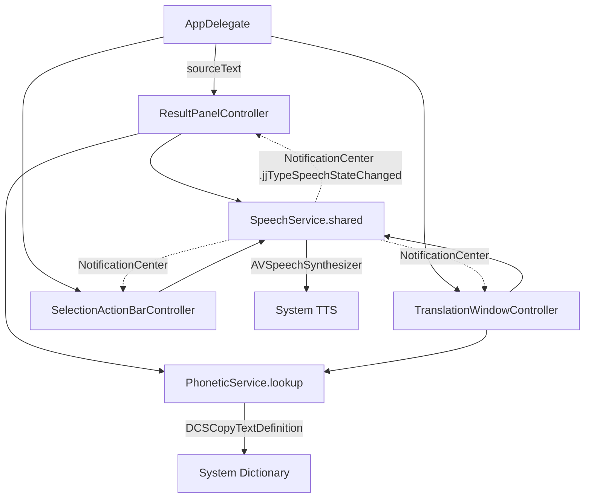

关，不得触碰。

- **朗读与剪贴板无关**：全程不读写 `NSPasteboard`，不会重现上一轮的剪贴板污染问题。
- **复用而非新建**：三个界面都是已存在并被复用的对象，只加子视图/状态，不新建窗口、不新增设置项、不新增权限。

## 架构设计



## 目录结构

```
jj-type/
├── Core/
│   ├── SpeechService.swift              # [NEW] 朗读服务单例。持有 AVSpeechSynthesizer；toggle(text) 同文本再点即停、否则先停后念；按 LanguageRouter.detect 选 en-US / zh-CN / 默认语音；speak 前 trim 空串直接返回；didFinish/didCancel 用 nonisolated + Task{@MainActor} 清状态并广播 .jjTypeSpeechStateChanged；暴露 isSpeaking(_:) 与 stop()。
│   └── PhoneticService.swift            # [NEW] 音标查询。lookup(_:completion:) 走串行队列（首次加载词典数十毫秒，禁止主线程同步）；仅接受单个英文单词（^[A-Za-z][A-Za-z'’-]*$，长度≤32）；DCSCopyTextDefinition → takeRetainedValue 后必须校验 entry.hasPrefix(word) 且音标组不含 CJK（实测 run 会命中中文词条瞤 rún）；解析第一个 |…| 组，按逗号切分取 BrE / AmE 各第一个读音拼 "BrE x · AmE y"；[String:String] + miss Set 缓存，上限 256 条整体清空。
├── Settings/
│   └── Theme.swift                      # [MODIFY] 新增 iconButton(symbol:toolTip:)：.rounded + .small、imageOnly、secondaryLabelColor 着色，供喇叭按钮使用。
└── Translate/
    ├── TranslationWindowController.swift # [MODIFY] 标题行改为 [sectionHeader, spacer, phoneticLabel, speakButton]（输入/译文各一行）；inputTextView.delegate = self + textDidChange 0.25s 防抖刷新音标与按钮可用性；prefillAndTranslate / clearClicked / restoreLastTranslation 也调用刷新（这三处不走 delegate）；点击 toggle 朗读，订阅状态通知切换图标；showResult 刷新译文音标；dismissWindow / willClose 停止朗读并复位。
    └── ResultPanelController.swift      # [MODIFY] 新增 sourceText、sourceRow（朗读原文小按钮 + 音标标签），插在 loadingRow 与 correctedCaption 之间；setState 中仅 result 态且 sourceText 非空时显示；showResult / showQuickResult 末尾 refreshSourceRow()；dismiss() 中 stop 朗读。
jj-type/
├── SelectionAction/
│   └── SelectionActionBarController.swift # [MODIFY] rebuildChips 首位插入「朗读」chip（不 dismiss，可再点停止），保存 barText 与 speakChip 引用，按状态通知切换「朗读/停止」标题；其它 chip 语义不变。
└── App/
    └── AppDelegate.swift                # [MODIFY] runPipeline 捕获成功处、selectionBar.onQuickAction 里同步 resultPanel?.sourceText；applicationWillTerminate 调用 SpeechService.stop()。
CHANGELOG.md                             # [MODIFY] 新增 1.9.0 条目（朗读 + 音标）。
AGENTS.md                                # [MODIFY] 模块表补 SpeechService / PhoneticService，更新 Translate 两行说明。
jj-type.xcodeproj/project.pbxproj        # [MODIFY] MARKETING_VERSION 1.9.0 / CURRENT_PROJECT_VERSION 38。
```

## 关键接口

```swift
final class SpeechService {
    static let shared: SpeechService
    var currentText: String? { get }
    func isSpeaking(_ text: String) -> Bool
    func toggle(_ text: String)                 // 同文本 => stop；否则先 stop 再 speak
    func speak(_ text: String)
    func stop()
}

enum PhoneticService {
    /// 仅对单个英文单词返回非 nil；在主线程回调。
    static func lookup(_ text: String, completion: @escaping (String?) -> Void)
}
```