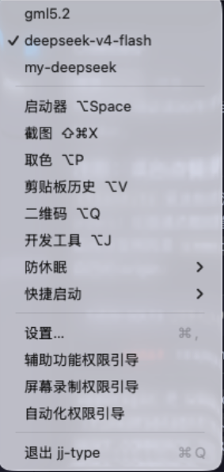
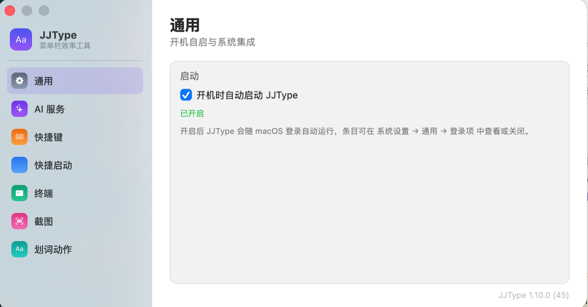

# JJType

一款常驻 macOS 菜单栏的效率工具：**选中文字就能 AI 翻译 / 纠正英文**，同时把截图标注、启动器、剪贴板历史、取色、二维码、开发工具、防休眠、输入法守护、网络守护等日常小工具收进一个 App。

纯原生 macOS 应用，无 Dock 图标，不占地方；所有 AI 请求走你自己配置的 OpenAI 兼容接口，API Key 只存在系统钥匙串里。

> 系统要求：macOS 14.0 及以上

---

## 界面介绍

### 菜单栏菜单

点击菜单栏的翻译图标即可展开：

- **顶部**：已配置的 AI 服务列表，勾选的是当前使用中的服务，点一下就能切换。
- **中部**：各功能入口，右侧显示当前生效的快捷键（图中为自定义后的示例，默认值见下方功能一览）。
- **防休眠 / 快捷启动 / 输入法 / 网络守护**：带箭头的二级菜单，分别用于临时阻止休眠、管理常用启动项、保持第三方输入法、以及查看网络守护状态。
- **底部**：「设置…」、三项权限引导（辅助功能 / 屏幕录制 / 自动化）以及退出。

### 设置窗口

设置窗口左侧是九个分区：**通用 / AI 服务 / 快捷键 / 快捷启动 / 终端 / 截图 / 划词动作 / 输入法 / 网络守护**，右侧是当前分区的卡片式设置项。

图示为「通用」页：勾选「开机时自动启动 JJType」即可注册为登录项，状态与 macOS 系统设置保持一致；窗口底部显示当前版本号。

---

## 功能一览

| 功能 | 默认快捷键 | 说明 |
|---|---|---|
| 翻译窗口 | `⌥ D` | 输入或选中文字，AI 翻译，可回填到原处 |
| 纠正 + 翻译 | `⌥ E` | 选中英文，先修语法再翻译，结果浮窗展示 |
| 划词动作条 | `⌥ S` | 选中文字后弹出 PopClip 式操作条 |
| 截图 | `⌘ ⇧ 2` | 多屏冻结、窗口高亮、9 种标注、OCR |
| 启动器 | `⌥ O` | Alfred 式搜索应用 / 文件 / 网址 / 系统命令 |
| 剪贴板历史 | `⌥ V` | 文本与图片历史，回车粘回 |
| 取色器 | `⌥ P` | 屏幕任意位置取色，HEX / rgb() |
| 二维码 | `⌥ Q` | 生成、保存、识别二维码 |
| 开发工具 | `⌥ J` | JSON / Base64 / URI 转换 |
| 防休眠 | 菜单栏 | 手动开启 / 30 分钟 / 1 小时 / 2 小时 |
| 输入法守护 | 菜单栏 | 切换 App 时把第三方输入法拉回来，不被系统切回 ABC |
| 网络守护 | 菜单栏 | 断网自动切备用 Wi-Fi、重启 VPN、打开 App，并推送 Webhook |

所有快捷键都可以在 **设置 → 快捷键** 里改成自己顺手的组合。

---

## 主要功能

### AI 翻译与英文纠正

- **翻译窗口（⌥D）**：像 Bob / Easydict 一样，打开一个输入窗口，粘贴或直接输入文字，回车翻译。译文可以一键复制，也可以直接替换回原来的输入框。
- **纠正 + 翻译（⌥E）**：选中一段英文，AI 先修语法和用词，再给出中文译文，结果以浮窗显示在选区旁边，支持「替换原文」和「复制」。
- **翻译时顺带修拼写**：翻译英文原文时，AI 会先修掉拼写错误再翻译，避免错字把译文带偏。修正结果不会直接覆盖你的输入，而是在输入框下方多出一行「拼写已纠正 … [应用]」，点「应用」才替换。
- **多 AI 服务**：可以配置多个 OpenAI 兼容服务（Base URL + API Key + 模型名），随时切换；设置里提供「连接测试」。
- **自定义动作**：内置「翻译 / 纠正 / 润色 / 改写」，也可以新建自己的动作，用 `{text}` 占位符写提示词。

### 划词动作条

选中文字后，光标下方会出现一条操作条，直接点「翻译 / 纠正 / 润色 / 改写 / 朗读 / 二维码」等动作，不用记快捷键。

- 可以在 **设置 → 划词动作** 里关闭「划词后自动显示」。
- 关闭后仍可用 `⌥S` 手动唤起；在浏览器、Electron 应用里这是最可靠的入口。
- 勾选「快捷键直接翻译」后，按 `⌥S` 会跳过动作条，直接翻译选中文字并弹出结果。
- 划词检测不会改动你的剪贴板。

### 截图与标注

按 `⌘⇧2` 进入截图：

- 多屏同时冻结，鼠标悬停可高亮窗口，拖动框选区域。
- **9 种标注工具**：矩形、椭圆、箭头、画笔、高亮、马赛克、文字、序号、橡皮。
- 撤销 / 重做，6 种颜色、3 种粗细；文字可单独设字体和字号，高亮可调透明度。
- **OCR 识别文字**：识别选区里的文字并复制到剪贴板。
- **钉图**：把截图钉在屏幕上，随时对照。
- **保存 / 复制**：默认保存到 `~/Pictures/JJType/`（可在设置里改目录和 PNG / JPEG 格式）；双击选区 = 复制并保存。
- 截图工具条和钉图都支持右键菜单，常用操作不用记快捷键。

### 启动器（⌥O）

Alfred 风格的快速启动：

- 搜索并打开已安装应用、文件夹、文件、网址。
- 支持中文 / 英文 / 首字母模糊匹配。
- 内置系统命令：锁屏、睡眠、重启、关机、注销、清空废纸篓（危险操作会先确认）。
- 没有匹配结果时，回车直接用默认浏览器搜索。
- 可以把常用应用 / 文件夹 / 网址加进「快捷启动」，并给每一项单独绑定全局快捷键。

### 剪贴板历史（⌥V）

- 自动记录复制过的**文本和图片**，最多保留 500 条。
- `↑` `↓` 选择，`⏎` 粘回原来的应用，`⌘⏎` 只复制不粘贴，`⌥⌫` 删除单条。
- 密码管理器等标记为「机密 / 临时」的内容会自动跳过，不会记录。
- 可在菜单栏菜单里随时开启 / 关闭记录。

### 取色器（⌥P）

- 屏幕任意位置取色，实时显示 HEX 与 `rgb()`，按空格切换格式。
- 点击即复制颜色值，并保留最近 12 个颜色，点一下就能再次复制。

### 二维码（⌥Q）

- 输入文字即时生成二维码，可保存 PNG 或复制图片。
- 支持从剪贴板识别二维码；截图工具条里也能识别选区中的二维码。
- 识别到网址时提供「打开网址」。

### 开发工具（⌥J）

一个窗口搞定常见转换：

- JSON 格式化 / 压缩（保持键顺序）。
- JSON ↔ 字符串互转。
- Base64 编码 / 解码。
- URI 编码 / 解码（与 JavaScript `encodeURIComponent` 语义一致）。
- JSON 结果支持树形折叠浏览，可右键复制值 / 键 / 子树；一键切换树形与文本。
- 关闭窗口即释放内容，不占内存。

### 防休眠

菜单栏菜单里可直接开启防休眠，支持「直到手动关闭 / 30 分钟 / 1 小时 / 2 小时」，菜单里会显示剩余时间，到点自动恢复。

### 输入法守护

macOS 会为每个 App 记住上次用的输入源，第三方输入法注册不完整时这个记忆会失效，切走再回来就变回系统 ABC。开启守护后，JJType 会在切换 App 时把输入法拉回你选中的那个。

- **目标输入法可选**：设置 → 输入法，从系统里已启用、可切换的输入法中选择（默认「自动」= 搜狗）。只列真正的输入法，不会把 ABC 这类键盘布局混进来。
- **两种纠正时机**：「切换 App 时纠正」（默认，只在切换瞬间拉回，不干预你在同一 App 内手动切 ABC）和「始终纠正」（任何时候被切走都拉回）。
- **不轮询**：监听系统的输入源变更通知，空闲时几乎不占 CPU。
- **没装就自动失效**：检测不到目标输入法时开关置灰，不会误切。

### 网络守护

断网后自动救场，并把结果推到 Webhook（Zoho Cliq 兼容格式）：

- **三层探测**：物理链路 → 国内链接 → 国外链接，区分「整个网断了」和「只有出国的路断了」。
- **断网自动切备用 Wi-Fi**：达到断网判定时长后，先开 Wi-Fi 再连指定 SSID，验证出网。
- **VPN 自动恢复**：国外不通时按需重启 OpenVPN Connect；半开状态会强制结束再重开。
- **恢复后打开指定 App**：可选，比如让依赖网络的客户端自动重连。
- **Webhook 通知**：断网、切网、恢复、失败都会推送；断网期间发不出去的消息进本地队列，恢复后按序补发。
- **心跳通知**：网络正常时每隔约 2 小时推一条「守护进程运行中」，确认守护没有悄悄退出。它借用正常的探测节奏，不额外开定时器；断网期间不发，网络恢复后从恢复那一刻重新计时。

### Finder「在终端中打开」

把 JJType 拖进 Finder 工具栏，之后在任意文件夹点一下，就能在终端里打开当前目录。

- 支持 Terminal、iTerm2、Warp、Ghostty、WezTerm、kitty、Alacritty，可在 **设置 → 终端** 里选择。
- 选中文件时打开它所在的文件夹；没有选中也没有打开的窗口时打开桌面。

### 朗读与音标

- 翻译窗口的「输入」「译文」两侧、划词结果浮窗、划词动作条都带朗读按钮，再点一次即停止。
- 语音按语言自动选择（英文 / 中文），单个单词读得稍慢。
- 输入是**单个英文单词**时，标题行会显示英美音标，例如 `英 [həˈləʊ] · 美 [həˈloʊ]`，完全离线。

---

## 下载

预编译版本放在仓库的 [apps/](apps/) 目录，按版本号分文件夹：

- 历史版本：浏览 [apps/](apps/) 目录

## 安装

1. 从 [apps/](apps/) 取对应版本的 `JJType.app`；也可以运行 `./build-release.sh` 自行构建，产物同样输出到 `apps/<版本号>/JJType.app`。
2. 把 `JJType.app` 拖进 `/Applications`（**建议放这里**，否则「开机自启」会指向当前所在目录）。
3. 双击打开。当前版本使用开发签名、尚未公证，首次打开如果被系统拦截，请到 **系统设置 → 隐私与安全性** 点「仍要打开」，或右键 App → 打开。

## 首次启动：授予权限

JJType 需要几项系统权限，缺少时会在对应功能里弹出中文引导窗口，点按钮即可跳到系统设置：

| 权限 | 用途 | 什么时候需要 |
|---|---|---|
| **辅助功能** | 读取选中文字、模拟复制 / 粘贴、全局快捷键 | 翻译、纠正、划词动作条、剪贴板粘回 |
| **屏幕录制** | 截屏、取色、识别二维码 | 截图、取色器、二维码识别 |
| **自动化** | 控制 Finder / 系统事件 | Finder「在终端中打开」、清空废纸篓、重启 / 关机 / 注销 |

> 屏幕录制权限**必须重启 App 才生效**，授权后引导窗口里有「重新启动」按钮。
> 自动化权限第一次触发时会弹系统询问，允许即可。

## 配置 AI 服务

打开 **设置 → AI 服务**：

1. 点「新建」，填入服务名称、Base URL（例如 `https://api.openai.com/v1`）、API Key 和模型名。
2. 点「连接测试」确认可用。
3. 保存后设为「使用中」。

API Key 只保存在系统钥匙串，不会写进配置文件。

## 设置项

菜单栏图标 → **设置…**（或 `⌘,`）：

- **通用**：开机自启。
- **AI 服务**：多服务管理与连接测试。
- **快捷键**：修改所有内置快捷键，冲突会提示。
- **快捷启动**：管理启动器里的应用 / 文件夹 / 文件 / 网址，以及每项的独立快捷键。
- **终端**：选择「在终端中打开」使用的终端 App。
- **截图**：保存目录、图片格式。
- **划词动作**：划词动作条开关、直接翻译开关、自定义动作编辑、清空剪贴板历史。
- **输入法**：目标输入法选择、纠正时机（切换 App 时 / 始终）。
- **网络守护**：备用 Wi-Fi、检查间隔、断网判定、VPN 与目标 App、Webhook 地址与心跳间隔。

---

## 常见问题

**快捷键没反应？**
到 **系统设置 → 隐私与安全性 → 辅助功能** 确认 JJType 已勾选；改完权限通常需要重启 App。

**截图是黑的 / 取色失败？**
授予「屏幕录制」权限后**重启 App**（macOS 只在启动时应用新权限）。

**「在终端中打开」没反应？**
首次点击需要在系统弹窗里允许 JJType 控制 Finder；如果之前拒绝过，到 **系统设置 → 隐私与安全性 → 自动化** 里重新勾选。

**划词动作条不出现？**
确认 **设置 → 划词动作** 里的开关已打开；浏览器 / Electron 应用里建议直接用 `⌥S`。

**剪贴板历史是空的？**
确认菜单栏菜单里的「剪贴板历史」已开启；密码管理器等标记为机密的内容会被主动跳过。

**AI 报错？**
在 **设置 → AI 服务** 里点「连接测试」，检查 Base URL、模型名和 API Key 是否正确。

**网络守护的心跳通知时间不准？**
心跳借用正常的探测节奏，不额外开定时器，所以实际间隔会比设定值多出一个「检查间隔」（默认 30 秒）。断网期间不发心跳，网络恢复后从恢复那一刻重新计时，因此恢复后要等满一个间隔才会收到下一条。

---

## 更新日志

版本变更见 [CHANGELOG.md](CHANGELOG.md)。当前版本：**1.13.0**。
